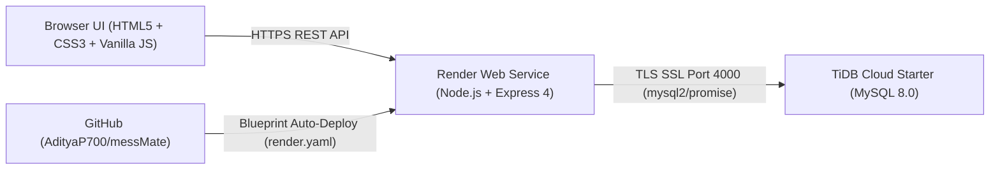

# MessMate — IIIT Bhubaneswar Mess Management & Waste Analytics System

**Live App:** [https://iiit-mess-mate.onrender.com](https://iiit-mess-mate.onrender.com)  
**Repository:** [https://github.com/AdityaP700/messMate](https://github.com/AdityaP700/messMate)

MessMate is a full-stack institutional dining operations, grievance redressal, and food-waste estimation platform built around IIIT Bhubaneswar's real campus dining workflow. Instead of assuming isolated hostel messes, it models shared dining across **Boys Wing** and **Girls Wing** between two independent vendor-operated halls — **Ground & 1st Floor Mess (Vendor 1)** and **New Mess (Vendor 2)** — alongside a **Student -> Mess Representative -> Vendor -> Dean** accountability pipeline.

---

## System Architecture



---

## Tech Stack

| Layer | Technology | Purpose |
| :--- | :--- | :--- |
| **Frontend** | HTML5, CSS3, Vanilla JS | Role-separated UI (`student`, `admin`, `superadmin`), custom glassmorphism design system, dark/light theme toggle, `Caveat` + `Plus Jakarta Sans` typography, inline SVG icons |
| **Backend** | Node.js (>= 18), Express 4 (`^4.21.2`) | Static delivery, modular REST APIs (`/api/auth`, `/api/student`, `/api/admin`, `/api/superadmin`), IST (`Asia/Kolkata`) time & cutoff enforcement |
| **Security & Uploads** | `bcryptjs`, `express-session`, `express-rate-limit`, `multer` | Password hashing (10 salt rounds), HTTP-only cookies, brute-force throttling (10 req / 15 min on auth), strict JPG/PNG upload validation (max 5 MB) |
| **Database** | MySQL 8.0 / TiDB Cloud Starter via `mysql2` (`^3.11.5`) | Connection pooling over TLS (`DB_SSL=true`), 11 normalized tables, prepared statements, transactional coupon generation, auto-bootstrap on fresh DB |
| **Hosting & CI** | Render Free Web Service (`render.yaml`), GitHub | HTTPS reverse proxy (`trust proxy = 1`), zero-config Blueprint deploy, automatic schema & demo dataset initialization |

---

## Real Campus Workflow & Roles

### 1. Dual-Vendor Shared Dining Model
- Students register with their residential wing (**Boys Wing** or **Girls Wing**) and choose a primary dining facility:
  - **`mess_1` — Ground & 1st Floor Mess** (`Vendor 1 — Main Hall`)
  - **`mess_2` — New Mess** (`Vendor 2 — New Wing`)
- Coupon purchases, counter meal claims, walk-in spot coupons, complaints, and kitchen prep projections are tracked per mess hall as well as campus-wide.

### 2. Student Portal (`/student/*`)
- **Prepaid Subscriptions & Digital Pass:** Select mess hall, date range, and per-day meal slots; upload UPI screenshot or choose cash at counter; view digital entry pass upon verification.
- **Pre-Meal Skips & Leave Pauses:** Skip individual active meals at least `skip_cutoff_minutes` (default 60 minutes IST) prior to serving start, or apply for multi-day mess leave which automatically pauses active coupons to `on_leave`.
- **Meal Ratings & Notice Board:** Rate today's meals (1–5 stars) and read Mess Committee announcements.
- **Two-Route Complaints (With Anonymous Option):** Submit complaints only during active IST serving hours, choosing either **Via Mess Representative** (student governing body for faster triage & vendor escalation) or **Direct Complaint** (to Mess Committee / Dean), with optional identity masking.

### 3. Mess Representative Portal (`/admin/*`)
- **Food Waste, Prep & SLA Dashboard:** Tracks live consumption (`ate`), `skipped`, `on_leave`, 7-day historical no-show projection, food saved vs. projected unclaimed waste (`kg` and `INR`), recommended kitchen prep plates per meal slot, and side-by-side Vendor 1 vs. Vendor 2 performance.
- **Grievance Triage & Vendor Escalation:** Filter complaints by `Status`, `Mess`, `Route`, or `Date`; move complaints from `open` / `in_progress` to **`escalated_to_vendor`** or **`resolved`** while recording **Vendor Coordination Notes**. Anonymous complainants remain masked (`Anonymous Student`).
- **Counter Operations:** Verify/reject pending payments (transactionally generating coupons), mark dining hall meal claims per mess, issue walk-in spot coupons, approve leaves, edit weekly menus, and publish notices.

### 4. Super Admin / Dean Portal (`/superadmin/*`)
- **Executive Oversight:** View monthly verified revenue, total coupons sold, average daily attendance, dual-vendor waste comparisons, and system-wide complaint redressal rate & resolution hours.
- **Policy & Governance:** Configure meal prices (`breakfast_price`, `lunch_price`, `snacks_price`, `dinner_price`), `skip_cutoff_minutes`, and `sunday_opt_in`; inspect daily reports; and provision or deactivate Mess Representative accounts scoped to `mess_1`, `mess_2`, or `all`.

---

## Database Schema (11 Tables)

Defined in [`schema.sql`](schema.sql) and synchronized idempotently via [`backend/server.js`](backend/server.js) and [`backend/utils/messConfig.js`](backend/utils/messConfig.js):

1. `users` — Students (`Boys Wing` / `Girls Wing`), Mess Representatives (`Student Body`), Super Admin (`Dean`), with `mess_hall` assignment and `role`
2. `menu` — 7-day timetable across `breakfast`, `lunch`, `snacks`, `dinner`
3. `mess_settings` — Configurable tariffs, skip cutoff minutes, and Sunday opt-in flag
4. `payments` — Cash and UPI payment submissions with receipt path and verification state
5. `coupons` — Individual meal passes keyed uniquely on `(student_id, meal_type, meal_date)` with `mess_hall` and lifecycle status (`active`, `used`, `skipped`, `on_leave`, `expired`)
6. `coupon_orders` — Multi-day prepaid subscription orders linked to `payments` and `mess_hall`
7. `mess_leave` — Leave date ranges (`end_date >= start_date`) that pause active coupons upon approval
8. `complaints` — Grievances with `mess_hall`, `routing_type` (`via_mess_rep`, `direct`), `is_anonymous`, `status` (`open`, `in_progress`, `escalated_to_vendor`, `resolved`), `response`, `vendor_note`, and `resolved_at`
9. `daily_reports` — Per-date meal, skip, spot-coupon, complaint, and revenue aggregations
10. `announcements` — Mess Notice Board posts (`info`, `important`)
11. `meal_ratings` — 1–5 star ratings (`uq_student_meal_rating`) per meal slot per day

---

## IST Serving Windows & Security Guardrails

- **Meal Windows (`Asia/Kolkata` / IST):**
  - **Breakfast:** `07:30 – 09:00`
  - **Lunch:** `12:00 – 14:00`
  - **Snacks:** `16:00 – 17:00`
  - **Dinner:** `19:30 – 21:00`
- **SQL Injection & XSS Defense:** Every query uses `mysql2` `?` prepared parameters; client rendering escapes untrusted text cleanly via `escapeHtml()` / `textContent`.
- **Idempotency & Overlap Guards:** Prevents overlapping coupon orders, overlapping leave dates, double payment verification, and out-of-window complaints or late skips.
- **Automated Maintenance:** Background hourly worker transitions unconsumed past `active` coupons to `expired`.

---

## Project Structure

```text
messMate/
├── backend/
│   ├── config/
│   │   ├── db.js                  # MySQL2 / TiDB TLS pool & host sanitizer
│   │   └── upload.js              # Multer disk storage (JPG/PNG, 5 MB limit)
│   ├── middleware/
│   │   ├── auth.js                # isAuthenticated (401) & hasRole (403)
│   │   └── rateLimiter.js         # Auth rate limiter (10 req / 15 min per IP)
│   ├── routes/
│   │   ├── auth.js                # Register, Login, Logout, /me
│   │   ├── student.js             # Menu, coupons, skip, leave, complaints, ratings, notices
│   │   ├── admin.js               # Claims, spot coupons, verify payments, complaints, stats
│   │   └── superadmin.js          # Settings, daily audit reports, admin management, overview
│   ├── scripts/
│   │   └── seedMockData.js        # 100 students, 3 Mess Reps, 10-day history seeder
│   ├── utils/
│   │   ├── analytics.js           # Food waste, kitchen prep & vendor SLA calculations
│   │   ├── messConfig.js          # Dual-mess catalog & safe schema column migrations
│   │   └── time.js                # IST clock helpers & meal window/cutoff checks
│   └── server.js                  # Express entrypoint, auto schema sync & maintenance loop
├── frontend/
│   ├── assets/
│   │   └── campus-bg.jpg          # Auth backdrop visual
│   ├── css/
│   │   └── style.css              # Glassmorphism UI + dark/light theme tokens
│   ├── js/
│   │   └── app.js                 # Shared API client, role guard, SVGs, formatters
│   ├── index.html                 # Showcase Sign-In portal with Quick Fill demo chips
│   ├── register.html              # Student signup (Wing & Primary Mess selector)
│   ├── student/                   # dashboard, menu, buy-coupon, my-coupons, mess-leave, complaints, payment-history
│   ├── admin/                     # dashboard, manage-menu, verify-payments, mark-claims, spot-coupon, leave-requests, complaints, students
│   └── superadmin/                # dashboard, daily-reports, manage-admins, settings
├── tests/
│   └── verify.js                  # Automated verification suite (npm test)
├── schema.sql                     # Full 11-table MySQL DDL + default seeds
├── render.yaml                    # Render Web Service Blueprint configuration
├── .env.example                   # Environment template
├── package.json
└── package-lock.json
```

---

## Local Setup

### 1. Prerequisites
- **Node.js** `>= 18.0.0`
- **MySQL** `8.0+` (or a TiDB Cloud Starter cluster)

### 2. Clone & Install
```bash
git clone https://github.com/AdityaP700/messMate.git
cd messMate
npm install
```

### 3. Initialize Database & Seed Dataset
```bash
mysql -u root -p < schema.sql
```
Copy `.env.example` to `.env` and update your credentials:
```env
PORT=3000
SESSION_SECRET=change_this_session_secret
NODE_ENV=development

DB_HOST=localhost
DB_PORT=3306
DB_USER=root
DB_PASS=root
DB_NAME=iiit_mess
DB_SSL=false
```

Seed the 100-student, 10-day dual-mess dataset (also runs automatically on server startup if `users <= 1` unless `DISABLE_DEMO_SEED=true`):
```bash
npm run seed
```

### 4. Run & Test
```bash
# Run verification suite
npm test

# Start server
npm start
# Or development watch mode
npm run dev
```
Open [http://localhost:3000](http://localhost:3000).

---

## Cloud Deployment (Render + TiDB Cloud Starter)

1. **Database (TiDB Cloud Starter — MySQL 8.0):**
   - Create a free Starter cluster on [TiDB Cloud](https://tidbcloud.com/), allow public network access (`0.0.0.0/0`), generate a password, and note `DB_HOST`, `DB_USER`, and `DB_PASS`.
2. **Backend & Static Frontend (Render):**
   - Deploy directly from [`render.yaml`](render.yaml) via [Render Blueprint Deploy](https://dashboard.render.com/blueprint/new?repo=https://github.com/AdityaP700/messMate).
   - Provide `DB_HOST`, `DB_USER`, and `DB_PASS` (`DB_PORT=4000`, `DB_NAME=test`, `DB_SSL=true`, and `NODE_ENV=production` are pre-configured in `render.yaml`).
   - On first startup, `ensureExtraTables()` creates all 11 tables and seeds the demo accounts automatically.

---

## Demo Accounts

All roles can also be filled with one click directly beneath the login card on `/` via **Quick Fill**:

| Role | Identifier / Email | Password | Scope |
| :--- | :--- | :--- | :--- |
| **Student (`mess_1`)** | `B122001` (`b122001@iiitbbsr.ac.in`) | `student123` | Boys Wing · Ground & 1st Floor Mess (`B122001`–`B122100` seeded) |
| **Student (`mess_2`)** | `B122002` (`b122002@iiitbbsr.ac.in`) | `student123` | Girls Wing · New Mess |
| **Mess Rep (`mess_1`)** | `REP001` (`rep1@iiitbbsr.ac.in`) | `admin123` | Student Governing Body · Ground & 1st Floor Mess |
| **Mess Rep (`mess_2`)** | `REP002` (`rep2@iiitbbsr.ac.in`) | `admin123` | Student Governing Body · New Mess |
| **Mess Coordinator** | `ADM001` (`messadmin@iiitbbsr.ac.in`) | `admin123` | Campus Mess Committee (`all` messes) |
| **Dean (Super Admin)** | `ADMIN001` (`dean@iiitbbsr.ac.in`) | `admin123` | Institute tariffs, audit reports, rep provisioning |

---

## Verification

Run `npm test` to validate [`tests/verify.js`](tests/verify.js):
- `schema.sql` 11-table definitions, dual-mess columns, and default seeds
- Dual-mess constants, routing modes, and vendor escalation statuses
- IST (`Asia/Kolkata`) time helpers and skip-cutoff validation
- Authentication & role-guard middleware (`401` / `403` enforcement)
- Multer upload configuration and all 23 frontend files
- Express bootstrap and route mounting on an ephemeral port
